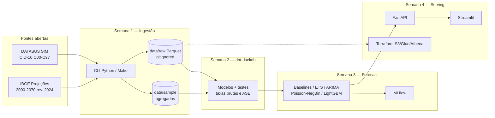

# Previsão de mortalidade por câncer no Brasil (até 2030)

Pipeline **end-to-end e reproduzível** que projeta a mortalidade por câncer **por tipo (CID-10) e UF** até 2030, usando dados abertos do **DATASUS (SIM)** e projeções populacionais do **IBGE**.

> Autor: **Eric Guerrize** — engenheiro de dados (Brasil).  
> Licença do código: **MIT**.  
> [PySUS](https://github.com/AlertaDengue/PySUS) (download SIM) é **GPL-3.0** e entra apenas como dependência opcional.

---

## Problema

O câncer é uma das principais causas de morte no Brasil, com padrões muito diferentes por **tipo tumoral**, **sexo**, **idade** e **UF**. Gestores e pesquisadores precisam de séries e projeções **transparentes, auditáveis e reproduzíveis** — não de caixas-pretas.

Este projeto monta um lakehouse analítico leve (Parquet + DuckDB/dbt) e modelos de previsão, com demo offline e CI desde a semana 1.

---

## Como rodar a demo (2 comandos)

```bash
python -m pip install -e ".[dev]"
make demo
```

Isso usa apenas `data/sample/` (agregados sintéticos / sem microdados reais, células &lt; 5 suprimidas) e **não precisa de rede**.

Com Docker:

```bash
docker compose run --rm demo
```

---

## Arquitetura (semana 1 → 4)



| Pasta | Função |
|-------|--------|
| `ingestion/` | Download SIM/IBGE, CID, agregação, CLI |
| `data/sample/` | Amostra agregada versionada (demo/CI offline) |
| `data/raw/` | Microdados/parquets baixados (**gitignored**) |
| `dbt/` | Semana 2 |
| `forecasting/` | Semana 3 |
| `api/`, `dashboard/` | Semana 4 |
| `infra/terraform/` | Semana 4 (opcional) |
| `tests/` | Pytest (CID, schema, supressão, mocks de rede) |

---

## Roadmap

- [x] **Semana 1** — Ingestão + Docker + CI + sample + README
- [ ] **Semana 2** — dbt-duckdb: grupos CID, taxas brutas e padronizadas (OMS), R00–R99, testes dbt
- [ ] **Semana 3** — Forecast: naive/drift, ETS/ARIMA, Poisson/NegBin, LightGBM, backtesting, MLflow
- [ ] **Semana 4** — FastAPI + Streamlit (+ Terraform S3/Glue/Athena opcional)

---

## Dados e citações

| Fonte | Uso | Referência |
|-------|-----|------------|
| **DATASUS / SIM** | Óbitos com causa básica CID-10; recorte **C00–C97**; monitoramento **R00–R99** | Ministério da Saúde. Sistema de Informações sobre Mortalidade (SIM). Acesso via FTP DATASUS / espelho Parquet [PySUS](https://github.com/AlertaDengue/PySUS). |
| **IBGE** | População por UF, sexo e idade simples, **2000–2070**, revisão **2024** (`projecoes_2024_tab1_idade_simples.xlsx`) | IBGE. [Projeções da População](https://www.ibge.gov.br/estatisticas/sociais/populacao/9109-projecao-da-populacao.html) · [FTP](https://ftp.ibge.gov.br/Projecao_da_Populacao/Projecao_da_Populacao_2024/) |

Detalhes de layout e colunas: [`docs/data-sources.md`](docs/data-sources.md).

---

## Comandos úteis

```bash
make setup    # ambiente de desenvolvimento
make lint     # ruff
make test     # pytest
make demo     # offline
make ingest   # download completo SIM (2018–2022) + IBGE → data/raw/
make docker-build
```

CLI:

```bash
cancer-mortality demo
cancer-mortality ingest-ibge
cancer-mortality ingest-sim --years 2018-2022 --ufs SP,RJ
cancer-mortality make-sample
```

Para ingestão SIM: `pip install -e ".[sim]"` (puxa PySUS/GPL).

---

## Ética e LGPD

- Artefatos versionados são **apenas agregados públicos** (e mocks sintéticos para CI).
- Microdados do SIM **não entram no Git** (`data/raw/` ignorado).
- Células com **menos de 5 óbitos** são suprimidas na amostra.
- As previsões são de **nível populacional** (UF × tipo × demografia), **não** estimam risco individual.

---

## Stack (semana 1)

Python 3.11+ · pandas · pyarrow · httpx · tenacity · typer · pydantic · ruff · pytest · Docker · GitHub Actions · PySUS (opcional, GPL)
