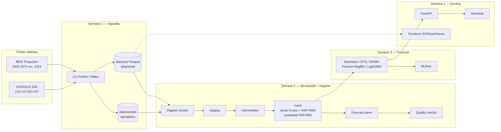

# Previsão de mortalidade por câncer no Brasil (até 2030)

Pipeline **end-to-end e reproduzível** que projeta a mortalidade por câncer **por tipo (CID-10) e UF** até 2030, usando dados abertos do **DATASUS (SIM)** e projeções populacionais do **IBGE**.

> Autor: **Eric Guerrize** — engenheiro de dados (Brasil).  
> Licença do código: **MIT**.  
> [PySUS](https://github.com/AlertaDengue/PySUS) (download SIM) é **GPL-3.0** e entra apenas como dependência opcional.

---

## Problema

O câncer é uma das principais causas de morte no Brasil, com padrões muito diferentes por **tipo tumoral**, **sexo**, **idade** e **UF**. Gestores e pesquisadores precisam de séries e projeções **transparentes, auditáveis e reproduzíveis** — não de caixas-pretas.

Este projeto monta um lakehouse analítico leve (Parquet + DuckDB/dbt), orquestração Dagster e baselines de previsão, com demo offline e CI.

---

## Como rodar a demo (2 comandos)

```bash
python -m pip install -e ".[dev]"
make demo
```

Isso usa apenas `data/sample/` e **não precisa de rede**.

**O que há em `data/sample/`:** agregados **reais** do SIM (DATASUS) para AC/SP/RJ, 2020–2022, com células &lt; 5 suprimidas; recorte **real** das projeções IBGE (rev. 2024); e um micro-mock **sintético** só para testes de re-agregação. **Sem microdados reais.** Detalhes em [`data/sample/README.md`](data/sample/README.md).

Com Docker:

```bash
docker compose run --rm demo
```

---

## Semana 2 — dbt + orquestração

```bash
pip install -e ".[dev,orchestration]"
make dbt-build          # staging → intermediate → marts (+ testes)
make dagster-job        # ingest → dbt → forecast naive → quality
# ou UI: make dagster  → http://localhost:3000
# ou:    docker compose up --build dagster
```

Artefatos em `data/processed/` (gitignored): DuckDB, forecast naive, relatório de qualidade.

---

## Arquitetura



### Linhagem dbt

```text
sample Parquet
  ├─ cancer_deaths_agg → stg_sim_cancer_deaths → int_cancer_deaths_labeled
  │                                                └─ int_deaths_with_population
  ├─ ibge_population_sample → stg_ibge_population → int_population_age_group ─┘
  │                              └─ fct_crude_mortality_rates
  │                              └─ fct_age_standardized_rates  (+ seed WHO)
  │                              └─ dim_cancer_groups           (+ seed labels)
  └─ ill_defined_counts → stg_sim_ill_defined → fct_ill_defined_quality
```

Detalhes: [`dbt/README.md`](dbt/README.md).

| Pasta | Função |
|-------|--------|
| `ingestion/` | Download SIM/IBGE, CID, agregação, CLI |
| `data/sample/` | Agregados **reais** SIM/IBGE (demo/CI offline) |
| `data/raw/` | Microdados/parquets baixados (**gitignored**) |
| `dbt/` | Modelos dbt-duckdb, seeds OMS/CID, testes |
| `orchestration/` | Dagster: ingest → dbt → forecast → quality |
| `forecasting/` | Baseline naive (semana 2); modelos na semana 3 |
| `api/`, `dashboard/` | Semana 4 |
| `infra/terraform/` | Semana 4 (opcional) |
| `tests/` | Pytest (CID, schema, supressão, mocks de rede) |

---

## Roadmap

- [x] **Semana 1** — Ingestão + Docker + CI + sample + README
- [x] **Semana 2** — dbt-duckdb (taxas brutas/ASR OMS, R00–R99, testes) + Dagster + CI dbt
- [ ] **Semana 3** — Forecast: naive/drift, ETS/ARIMA, Poisson/NegBin, LightGBM, backtesting, MLflow
- [ ] **Semana 4** — FastAPI + Streamlit (+ Terraform S3/Glue/Athena opcional)

---

## Dados e citações

| Fonte | Uso | Referência |
|-------|-----|------------|
| **DATASUS / SIM** | Óbitos com causa básica CID-10; recorte **C00–C97**; monitoramento **R00–R99** | Ministério da Saúde. Sistema de Informações sobre Mortalidade (SIM). Acesso via FTP DATASUS / espelho Parquet [PySUS](https://github.com/AlertaDengue/PySUS). |
| **IBGE** | População por UF, sexo e idade simples, **2000–2070**, revisão **2024** (`projecoes_2024_tab1_idade_simples.xlsx`) | IBGE. [Projeções da População](https://www.ibge.gov.br/estatisticas/sociais/populacao/9109-projecao-da-populacao.html) · [FTP](https://ftp.ibge.gov.br/Projecao_da_Populacao/Projecao_da_Populacao_2024/) |
| **OMS** | População-padrão mundial para ASR (método direto) | Ahmad et al. (2001), WHO World Standard — seed `dbt/seeds/who_world_standard_population.csv` |

Detalhes de layout e colunas: [`docs/data-sources.md`](docs/data-sources.md).

---

## Orquestração: por que Dagster?

A vaga aceita **Airflow ou Dagster**. Escolhemos **Dagster** para o portfolio local:

- **1 serviço** no compose (`dagster dev`) vs webserver + scheduler + Postgres do Airflow
- Assets espelham a linhagem dbt (ingest → transform → forecast → quality)
- Mesmo fluxo que um DAG Airflow teria, documentado em [`orchestration/README.md`](orchestration/README.md)

---

## Comandos úteis

```bash
make setup         # pacote + dbt + dagster
make lint          # ruff
make test          # pytest
make demo          # offline
make dbt-build     # dbt deps + build (sample)
make dagster       # UI em :3000
make dagster-job   # job completo via CLI
make ingest        # download completo SIM (2018–2022) + IBGE → data/raw/
make docker-build
docker compose up --build dagster
```

CLI:

```bash
cancer-mortality demo
cancer-mortality ingest-ibge
cancer-mortality ingest-sim --years 2018-2022 --ufs SP,RJ
cancer-mortality make-sample
```

Extras: `pip install -e ".[sim]"` (PySUS/GPL) · `".[dbt]"` · `".[orchestration]"`.

---

## Ética e LGPD

- Em `data/sample/` versionamos **agregados públicos reais** (SIM/IBGE) com células &lt; 5
  suprimidas, mais um mock sintético auxiliar — **nunca** microdados do SIM.
- Microdados brutos ficam só em `data/raw/` (**gitignored**).
- As previsões são de **nível populacional** (UF × tipo × demografia), **não** estimam risco individual.
- Teste dbt customizado `deaths_null_when_suppressed` garante que células suprimidas não vazam contagens.

---

## Stack

Python 3.11+ · pandas · pyarrow · httpx · tenacity · typer · pydantic · **dbt-duckdb** · **Dagster** · ruff · pytest · Docker · GitHub Actions · PySUS (opcional, GPL)
